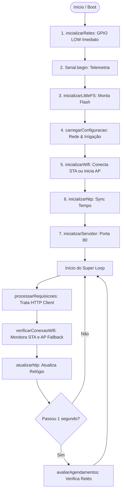

# Guia de Estudos — Firmware IrrigaSolo 🌱

Este documento serve como um manual didático detalhado para estudantes de tecnologia e sistemas embarcados. Ele descreve a arquitetura geral do firmware **IrrigaSolo** e detalha o funcionamento conceitual e prático de cada um de seus cinco módulos fundamentais.

---

## 1. Descrição Geral do Projeto

O **IrrigaSolo** é um firmware para microcontroladores baseado no chip **ESP8266** (NodeMCU), projetado para controlar a irrigação de jardins através de 2 canais independentes (relés ativando válvulas solenoides). Suas principais premissas de projeto são:
* **Autonomia Temporal:** Sincronização do relógio via NTP com fallback para oscilador interno caso a internet caia.
* **Segurança e Confiabilidade:** Pinos de hardware são forçados a estados seguros no instante do boot e no caso de arquivos de configuração corrompidos.
* **Persistência Local Dedicada:** Armazenamento em arquivos JSON no LittleFS separados por domínio de interesse (Rede vs. Irrigação) para prevenir desgaste prematuro e corrupção cruzada.
* **Interface Web Embutida Leve com Partials:** A interface de controle é guardada na memória flash do controlador (`PROGMEM`) em formato compactado. Para manter o código limpo e evitar redundância (DRY - *Don't Repeat Yourself*), o firmware utiliza um sistema de **partials** (templates parciais para `<head>` e `<footer>`) que são dinamicamente mesclados pelo script `html2c.py` em tempo de compilação. As alterações de estado em tempo de execução são feitas de modo assíncrono via chamadas de API JSON (Fetch API), evitando o recarregamento total de páginas.
* **Arquitetura Baseada em Super Loop Não-Bloqueante:** Proibição do uso de `delay()` para garantir que o Watchdog Timer (WDT) não reinicie a placa e as pilhas de comunicação Wi-Fi operem com fluidez.

---

## 2. Diagrama de Fluxo Geral (Inicialização e Loop)

O fluxo principal do firmware localiza-se no arquivo [main.cpp](file:///home/rpb/Documentos/PlatformIO/Projects/IrrigacaoJardins/src/main.cpp).



---

## 3. Detalhamento Técnico dos Módulos

### 3.1. Módulo de Persistência (`persistencia.h` / `persistencia.cpp`)
* **Conceito Abstrato:** Este módulo abstrai a leitura e escrita de dados no sistema de arquivos **LittleFS**. Ele converte estruturas em C/C++ para strings JSON e vice-versa, utilizando a biblioteca **ArduinoJson (v7)**. Para evitar alocações dinâmicas na memória RAM (evitando fragmentação e crashes), utiliza buffers estáticos e otimizados. 
* **Lógica de Fail-Safe:** Se o arquivo de configuração estiver ausente ou corrompido, o firmware aplica configurações padrão seguras imediatamente (relés desligados e modo Wi-Fi em Access Point para possibilitar reconfiguração).

**Demonstração em Código:**
O método a seguir mostra como as sessões do Canal 1 são lidas de `/irrigation.json` e como o WDT é alimentado usando `yield()` ao processar grandes arrays JSON em hardware embarcado:

```cpp
// Trecho extraído de src/persistencia.cpp
// Deserializar sessões do Canal 1
JsonArray arrayCh1 = documento["channel1"].as<JsonArray>();
for (uint8_t i = 0; i < MAX_SESSOES_POR_CANAL; i++) {
    if (arrayCh1 && i < arrayCh1.size()) {
        JsonObject sessao = arrayCh1[i];
        configIrrigacao.canal1[i].habilitada = sessao["enabled"] | false;
        strlcpy(configIrrigacao.canal1[i].inicio,
                sessao["start"] | "00:00",
                sizeof(configIrrigacao.canal1[i].inicio));
        configIrrigacao.canal1[i].duracao = sessao["duration"] | 0;
    } else {
        // Slots não definidos no JSON ficam desabilitados
        configIrrigacao.canal1[i].habilitada = false;
        strlcpy(configIrrigacao.canal1[i].inicio, "00:00",
                sizeof(configIrrigacao.canal1[i].inicio));
        configIrrigacao.canal1[i].duracao = 0;
    }
    yield(); // Alimentar o WDT durante parsing de arrays (restrição embarcada)
}
```

---

### 3.2. Módulo de Rede Wi-Fi (`redeWifi.h` / `redeWifi.cpp`)
* **Conceito Abstrato:** Gerencia a conexão Wi-Fi nos modos **STA** (Estação, conectado ao roteador da casa) e **AP** (Access Point, criando uma rede própria do IrrigaSolo para configuração). O LED de status informa o estado atual: piscando se estiver em modo AP (aguardando rede) ou aceso se estiver conectado à rede local em modo STA.
* **Decisão Arquitetural Importante (ADR-003):** O firmware chama `WiFi.persistent(false)` para desabilitar o cache automático de credenciais na Flash nativo do SDK do ESP8266. Isso preserva a Flash e torna os arquivos JSON locais a única fonte de verdade.
* **Timeout Não-bloqueante e Fallback (RF2.3):** A tentativa de conexão na rede local tem um limite de tempo. Se falhar, o dispositivo gera seu próprio AP de forma não-bloqueante sem congelar a execução do sistema de irrigação.

**Demonstração em Código:**
Abaixo está o loop de conexão com timeout não-bloqueante que protege o Watchdog Timer usando `yield()`:

```cpp
// Trecho extraído de src/redeWifi.cpp
static bool tentarConexaoSta() {
    Serial.print(F("[INFO] Tentando conectar à rede: "));
    Serial.println(configRedeLocal.ssidSta);

    WiFi.mode(WIFI_STA);
    WiFi.begin(configRedeLocal.ssidSta, configRedeLocal.senhaSta);

    unsigned long inicioTentativa = millis();

    while (WiFi.status() != WL_CONNECTED) {
        // Timeout atingido — conexão falhou
        if (millis() - inicioTentativa >= TIMEOUT_CONEXAO_STA_MS) {
            Serial.println(F("\n[WARN] Timeout de conexão STA atingido."));
            return false;
        }
        yield(); // Alimenta o WDT e processa pilhas de rede
        delay(100); // Pequeno intervalo para não saturar o loop
    }
    
    modoApAtivo = false;
    // ...
    return true;
}
```

---

### 3.3. Módulo de Sincronização NTP (`relogioNtp.h` / `relogioNtp.cpp`)
* **Conceito Abstrato:** Utiliza o protocolo NTP (*Network Time Protocol*) para sincronizar o relógio interno do ESP8266. O fuso horário e a frequência de sincronização são parametrizáveis.
* **Funcionamento com Falha de Conectividade:** Caso a conexão à rede local caia, o objeto `NTPClient` estima o tempo de forma autônoma baseando-se no contador interno de milissegundos do chip (`millis()`). A precisão sofre um desvio sutil com o tempo (*drift*), mas o sistema continua operando a rega normalmente.

**Demonstração em Código:**
Conversão de data/hora a partir do Epoch UTC sincronizado, aplicando fuso horário e gerando string em Português:

```cpp
// Trecho extraído de src/relogioNtp.cpp
String obterDataFormatada() {
    unsigned long epochTime = clienteNtp.getEpochTime();
    time_t rawTime = (time_t)epochTime;
    struct tm* timeInfo = gmtime(&rawTime);

    char bufferData[32];
    snprintf(bufferData, sizeof(bufferData), "%02d de %s de %d",
             timeInfo->tm_mday,
             NOMES_MESES[timeInfo->tm_mon], // tm_mon: 0–11
             timeInfo->tm_year + 1900);

    return String(bufferData);
}
```

---

### 3.4. Módulo Agendador (`agendador.h` / `agendador.cpp`)
* **Conceito Abstrato:** É o motor de regras que decide se um relé deve ligar ou desligar. O tempo é avaliado como "minutos desde meia-noite" (um valor de 0 a 1439). Cada sessão programada cria uma **janela de irrigação** dada por `[minutoInicio, minutoInicio + duracao)`. O agendador lê as sessões ativas e verifica se o minuto atual se enquadra nelas.
* **Validação de Conflitos (ADR-006):** Para evitar que os dois canais operem juntos e reduzam a pressão da água (quando a simultaneidade é proibida), o firmware executa uma validação geométrica de intervalos cruzados antes de salvar os dados.

**Diagrama de Validação de Sobreposição:**
```
Janela 1 (Canal 1): [a ----------------- b)
Janela 2 (Canal 2):           [c --------------- d)
Há sobreposição se: a < d  E  c < b  (Resulta em Conflito!)
```

**Demonstração em Código:**
Abaixo está a função de validação geométrica das janelas de rega e a avaliação periódica no loop:

```cpp
// Trecho extraído de src/agendador.cpp
static bool janelasSeOverpoem(int inicio1, uint8_t duracao1, int inicio2, uint8_t duracao2) {
    int fim1 = inicio1 + duracao1;
    int fim2 = inicio2 + duracao2;

    // Duas janelas [a, b) e [c, d) se sobrepõem se a < d && c < b
    return (inicio1 < fim2) && (inicio2 < fim1);
}
```

```cpp
// Trecho extraído de src/agendador.cpp (avaliação de canais no loop)
if (minutoAtual >= minutosInicio && minutoAtual < (minutosInicio + sessao.duracao)) {
    canal1DeveEstarLigado = true;
    break; // Basta uma sessão ativa para ligar o canal
}
```

---

### 3.5. Módulo Servidor Web (`servidorWeb.h` / `servidorWeb.cpp`)
* **Conceito Abstrato:** Cria um servidor HTTP ouvindo na porta 80. Ele serve as páginas HTML embutidas na memória Flash e disponibiliza rotas de API REST leves que devolvem e aceitam JSON.
* **Minimização de Uso da RAM:** Em vez de manter grandes strings HTML em memória RAM, o firmware utiliza o modificador `PROGMEM` (`servidor.send_P`), fazendo com que o microcontrolador envie os dados direto da Flash do dispositivo para a rede.

**Demonstração em Código:**
Declaração de endpoints HTTP e envio de páginas a partir da memória de programa (`PROGMEM`):

```cpp
// Trecho extraído de src/servidorWeb.cpp
void inicializarServidor(ConfiguracaoRede* configRede, ConfiguracaoIrrigacao* configIrrigacao) {
    ptrConfigRede      = configRede;
    ptrConfigIrrigacao = configIrrigacao;

    // Páginas HTML (servidas de PROGMEM)
    servidor.on("/",         HTTP_GET,  handlePaginaIndex);
    servidor.on("/horarios", HTTP_GET,  handlePaginaHorarios);
    servidor.on("/config",   HTTP_GET,  handlePaginaConfig);

    // Endpoints de API REST
    servidor.on("/api/status",  HTTP_GET,  handleApiStatus);
    servidor.on("/api/control", HTTP_POST, handleApiControl);
    servidor.on("/api/schedules", HTTP_POST, handleApiPostSchedules);
    // ...
    servidor.begin();
}
```

---

### 3.6. Módulo do Pipeline de Templates Parciais (`html2c.py` / `include/templates/`)
* **Conceito Abstrato:** Para evitar a duplicação em massa de folhas de estilo CSS, fontes externas e rodapés em todas as páginas HTML, o projeto separa esses elementos em arquivos parciais (`head.html` e `footer.html`).
* **Compilação do HTML (Pré-processamento):** Em tempo de compilação, o script em Python `html2c.py` mescla de forma transparente esses blocos de código em todas as páginas que possuem os delimitadores comentados `<!-- template:head -->` e `<!-- template:footer -->` antes de serializar o resultado final como cabeçalhos C++ com arrays de dados `PROGMEM`.

**Demonstração em Código (Python):**
O trecho abaixo do script `html2c.py` mostra como a mesclagem é realizada no computador antes da geração do código do ESP8266:

```python
# Aplica o pré-processamento dos partials/templates
if head_partial:
    html_content = html_content.replace("<!-- template:head -->", head_partial)
if footer_partial:
    html_content = html_content.replace("<!-- template:footer -->", footer_partial)
```

---

## 4. Questões Rápidas de Revisão (Para a Prova 📝)

1. **Por que não devemos utilizar `delay()` no `loop()` principal de um firmware IoT?**
   * *Resposta:* O `delay()` é bloqueante. Ele impede que as pilhas de rede Wi-Fi e os clientes HTTP sejam processados, além de impedir o disparo correto do Watchdog Timer (WDT), resultando em travamento ou reset do hardware.
2. **O que acontece se o arquivo `/irrigation.json` estiver corrompido?**
   * *Resposta:* O módulo de persistência intercepta o erro de desserialização (JSON inválido), aplica defaults seguros (todas as sessões desabilitadas, relés inativos) e impede acionamentos incorretos no boot do sistema.
3. **Qual é o papel da instrução `WiFi.persistent(false)`?**
   * *Resposta:* Ela instrui o SDK do ESP8266 a não gravar dados de conexão Wi-Fi na Flash interna a cada chamada de boot do rádio, evitando o desgaste prematuro da memória Flash e mantendo o LittleFS como única fonte de verdade.
4. **Qual é a vantagem de utilizar o sistema de partials (templates parciais) na interface web do IrrigaSolo?**
   * *Resposta:* A vantagem é a modularidade e facilidade de manutenção (DRY - *Don't Repeat Yourself*). O desenvolvedor altera a folha de estilo ou a estrutura base da tag `<head>` em um único arquivo parcial (`head.html`) e o script de build propaga a mudança automaticamente para todas as páginas em tempo de compilação, sem gerar qualquer overhead de processamento ou consumo extra de RAM no hardware do ESP8266.
5. **Por que a rota `/update` do servidor web é uma alternativa mais robusta à atualização OTA tradicional do Arduino (Push)?**
   * *Resposta:* A rota `/update` baseia-se em um fluxo baseado em Pull (onde o navegador envia o binário via requisição HTTP padrão). Isso elimina problemas de bloqueio de firewall local que costumam interromper o ArduinoOTA nativo e permite atualizar o dispositivo de forma universal a partir de qualquer dispositivo conectado na mesma rede (ou no AP do próprio ESP8266), inclusive usando smartphones.

---

## 5. Resolução de Problemas: Permissões de Porta Serial (Linux) 🔌

Caso ocorra um erro de permissão ao tentar realizar o upload do firmware ou acessar o Serial Monitor do PlatformIO (ex: `Permission denied: '/dev/ttyUSB0'`), o problema está relacionado ao fato de o seu usuário do Linux não ter permissões para acessar dispositivos seriais.

### Solução Definitiva

As portas seriais como `/dev/ttyUSB0` pertencem ao grupo `dialout` (ou `uucp` em algumas distribuições). Para conceder acesso permanente ao seu usuário sem a necessidade de usar `sudo` para cada operação de gravação, siga o procedimento:

1. **Adicionar o usuário ao grupo `dialout`**:
   Execute o seguinte comando no terminal (substituindo `rpb` pelo seu usuário atual, ou usando a variável `$USER`):
   ```bash
   sudo usermod -a -G dialout rpb
   ```

2. **Aplicar as alterações**:
   Para que as permissões do grupo sejam atualizadas, é necessário **fazer logout (encerrar a sessão)** do Linux e login novamente, ou simplesmente reiniciar o computador.

3. **Verificação rápida**:
   Você pode verificar se o seu usuário já faz parte do grupo executando o comando `groups` no terminal. Ele deve listar `dialout` entre as opções.

---

## 6. Guia Prático de Gravação e Operação do ESP-01S com Módulo Relé ⚡

O **ESP8266 ESP-01S** é um módulo ultracompacto que apresenta particularidades elétricas fundamentais para seu correto funcionamento e gravação:

### 6.1. Pinagem e Comportamento dos Pinos no Boot

O ESP-01S possui apenas 8 pinos:
* **VCC (3.3V) e GND:** Alimentação. Atenção: O ESP-01S requer picos de corrente de até 300mA durante transmissões de rádio Wi-Fi. Nunca alimente o chip diretamente com saídas de 3.3V de conversores USB-TTL genéricos sem regulador adequado.
* **CH_PD / EN:** Pino de habilitação do chip. No modelo ESP-01S, possui resistor de pull-up interno soldado na própria placa (ao contrário do ESP-01 clássico).
* **RST:** Pino de reset (ativo em nível baixo).
* **TX (GPIO 1) e RX (GPIO 3):** Comunicação serial a 115200 bps.
* **GPIO 0:** Pino de controle do relé. No boot, o ESP8266 inspeciona este pino:
  * Se estiver em **HIGH**: Inicializa normalmente executando o firmware da memória Flash SPI.
  * Se estiver em **LOW**: Entra no modo *Bootloader UART Download* para receber novo código.
* **GPIO 2:** Conectado ao LED onboard azul do ESP-01S. Opera em lógica invertida (**LOW = aceso**, **HIGH = apagado**).

### 6.2. Como Gravar o Firmware via Adaptador USB-Serial (FTDI / CH340)

Para gravar o ESP-01S pela primeira vez:
1. Conecte TX do adaptador ao RX do ESP-01S, e RX do adaptador ao TX do ESP-01S.
2. Conecte GND comum e VCC a 3.3V (com regulador estável).
3. **Colocar em modo Bootloader:** Antes de energizar a placa, conecte o pino **GPIO 0 ao GND**. Energize o circuito.
4. Execute o comando de compilação e upload:
   ```bash
   /home/rpb/.platformio/penv/bin/pio run -e esp01_1m --target upload
   ```
5. Desconecte o GPIO 0 do GND e reinicie a placa. O firmware inicializará em modo de execução normal.
6. A partir deste ponto, novas versões do firmware podem ser atualizadas sem fios via **OTA** acessando a rota `http://<IP_DO_ESP01>/update`.

### 6.3. Problema do Pulso de Inicialização no Relé e Solução

Conforme discutido no [fórum oficial do Arduino](https://forum.arduino.cc/t/esp01-modulo-rele-problemas-na-inicializacao/1320931):
* No boot inicial do ESP8266, a ROM de inicialização pode apresentar pequenas flutuações de tensão no GPIO 0 antes de o código do usuário executar.
* No módulo relé v4.0 com transistor NPN, o acionamento do relé ocorre quando o pino está em **HIGH**.
* Para mitigar disparos espúrios e ruídos de chaveamento elétrico no mundo real:
  1. A primeira instrução executada no `setup()` do firmware configura `pinMode(PINO_RELE_CANAL_1, OUTPUT)` e escreve imediatamente `digitalWrite(PINO_RELE_CANAL_1, LOW)`.
  2. A rotina não-bloqueante `verificarEProtegerEstadoReleFisico()` é executada continuamente no Super Loop. Se o pino físico for encontrado em `HIGH` sem autorização explícita do motor de agendamento ou controle manual, a válvula é desligada imediatamente e o evento espúrio é registrado.

### 6.4. Por que o ESP-01S (1MB) é Mandatório para Suportar Atualizações OTA?

A escolha do **ESP-01S** em vez do ESP-01 clássico é uma decisão técnica de arquitetura motivada pela viabilidade de atualizações remotas (*Over-The-Air*):

1. **A Restrição do ESP-01 Tradicional (512 KB / 4 Mbit):**
   * Os módulos ESP-01 mais antigos utilizam chips de memória Flash SPI de apenas **512 KB**.
   * O mecanismo de atualização OTA do ecossistema Arduino/ESP8266 utiliza a estratégia *Two-Bank (A/B)*: enquanto o firmware antigo está em execução na partição primária, o novo binário é gravado integralmente na partição secundária temporária. Somente após a validação de integridade (soma de verificação MD5) o bootloader (*eboot*) inverte os ponteiros de inicialização e reinicia no novo código.
   * Portanto, em uma Flash de 512 KB, o firmware não pode exceder aproximadamente **240 KB**.
   * Como o firmware do IrrigaSolo integra as pilhas de Wi-Fi, Servidor Web HTTP, cliente MQTT (PubSubClient), sincronização NTP e parser JSON (ArduinoJson v7), o binário compilado atinge cerca de **443 KB**, tornando o OTA **impossível** no ESP-01 de 512 KB.

2. **A Solução com o ESP-01S (1 MB / 8 Mbit):**
   * O ESP-01S vem de fábrica com chip Flash de **1 MB (1024 KB)**.
   * Com o mapa de partição `eagle.flash.1m64.ld` (64 KB para o sistema de arquivos LittleFS e restante para código), a partição total para firmware suporta binários de até aproximadamente 470 KB em modo OTA de duplo banco.
   * Nosso firmware compilado ocupa **443.235 bytes (46.2%)**, mantendo-se rigorosamente abaixo da margem de 50%, o que garante estabilidade e espaço suficiente para atualizações sem fio transparentes via rota `/update`.
   * **Manutenção em Campo:** Como o ESP-01S opera acoplado diretamente à placa de relé (muitas vezes em caixas estanques ou quadros elétricos próximos ao jardim), o suporte a OTA elimina a necessidade de desmontar o equipamento, desconectar a fiação de 220V e levar a placa para a bancada para reprogramação cabeada via conversor USB-TTL.

---

### 6.5. Guia de Diagnóstico: "Gravei o Firmware com Sucesso, mas a Placa não Conecta e Nem Entra no Modo AP"

Quando o firmware é gravado com 100% de sucesso pelo `esptool`, mas ao energizar o conjunto a placa não se conecta à rede nem emite o sinal Wi-Fi do Access Point (`IrrigaSolo`), existem **4 causas técnicas clássicas** na arquitetura do ESP8266 acoplado a módulos relé.

Abaixo está o procedimento sistemático de isolamento para identificar e corrigir o problema:

#### 1. Incompatibilidade do Modo de Acesso à Flash SPI (`QIO` vs `DOUT`) — Causa mais provável
* **O Fenômeno:** Por padrão, ferramentas de compilação como o PlatformIO utilizam o modo `QIO` (Quad I/O) para placas genéricas ESP8266. No entanto, grande parte dos módulos ESP-01S modernos utiliza chips de memória Flash SPI (como PUYA ou clones GigaDevice) que não suportam comunicação de 4 vias na inicialização da ROM do bootloader.
* **O Sintoma:** A gravação via USB serial conclui com sucesso (pois o `esptool` grava em modo SPI básico). Porém, ao reiniciar, a ROM não consegue ler o código na Flash e o chip entra em um ciclo infinito de reinicializações (*boot loop / crash*). Como o código do Arduino nunca chega a executar a função `setup()`, o Wi-Fi nunca é ativado.
* **A Solução:** Adicionar explicitamente `board_build.flash_mode = dout` no arquivo `platformio.ini`. O modo **DOUT** (Dual Output) é universalmente compatível com todas as variantes de chips Flash do ESP-01S. O binário gerado passa a conter o byte de controle `0x03` no cabeçalho do bootloader, garantindo inicialização estável.

#### 2. Conflito no Pino de Bootstrapping (GPIO 0 Mantido em Nível LOW pelo Módulo Relé)
* **O Fenômeno:** No ecossistema ESP8266, o pino **GPIO 0** é um pino especial de *strapping* (seleção de modo de inicialização da CPU):
  * **GPIO 0 em HIGH no boot:** Inicializa em modo normal executando o código gravado na memória Flash (`boot mode:(3,x)`).
  * **GPIO 0 em LOW no boot:** O microcontrolador não executa o firmware da Flash; em vez disso, entra em modo *Bootloader UART Download* (`boot mode:(1,x)`), ficando eternamente estático à espera de uma gravação serial.
* **O Problema no Módulo Relé:** Em várias placas de relé comerciais para ESP-01 (incluindo versões do módulo relé v4.0), o pino GPIO 0 está conectado à base de um transistor ou optoacoplador sem um circuito de pull-up forte o suficiente, ou o próprio circuito puxa o pino para 0V durante o instante de energização.
* **Procedimento de Teste e Isolamento:**
  1. Retire o ESP-01S do soquete do módulo relé.
  2. Insira o ESP-01S no adaptador USB-Serial (garantindo que o pino GPIO 0 **NÃO** esteja aterrado ao GND).
  3. Conecte à porta USB e aguarde 15 a 20 segundos.
  4. Abra o leitor de redes Wi-Fi do seu celular ou computador:
     * **Se a rede `IrrigaSolo` aparecer no adaptador USB:** O firmware está perfeitamente funcional e gravado em DOUT. O culpado comprovado é o hardware do módulo relé segurando o pino GPIO 0 em nível baixo.
* **Soluções de Hardware se o módulo relé puxar o GPIO 0:**
  * Soldar um resistor de pull-up externo de 4.7kΩ ou 10kΩ entre o pino GPIO 0 e o pino VCC (3.3V) da placa.
  * Ou aplicar a modificação de hardware amplamente documentada na comunidade IoT (cortar a trilha de controle do GPIO 0 e jumpear para o pino RX/GPIO 3).

#### 3. Corrente Insuficiente na Alimentação de 5V (Brownout Reset)
* **O Fenômeno:** O transmissor de rádio Wi-Fi do ESP8266 consome picos transientes entre 300mA e 430mA.
* **O Sintoma:** A placa tenta inicializar, mas no exato milissegundo em que o rádio Wi-Fi é ligado (no início do `inicializarWifi`), a tensão de 3.3V sofre uma queda brusca (*voltage sag*), acionando o circuito de proteção de subtensão (*Brownout Reset*), reiniciando o microcontrolador antes que o sinal Wi-Fi seja irradiado.
* **A Solução:** Certifique-se de que a fonte de alimentação de 5V conectada aos bornes do módulo relé tenha capacidade real de fornecer no mínimo 1A (1000mA). Evite alimentar o módulo relé a partir de portas USB não energizadas ou cabos excessivamente longos e finos.

#### 4. Janela de Timeout de Conexão STA (Aguardar 15 Segundos)
* **O Fenômeno:** Caso o LittleFS esteja vazio ou recém-formatado, o firmware carrega as credenciais de rede padrão e tenta se conectar durante **15 segundos** (`TIMEOUT_CONEXAO_STA_MS = 15000`) antes de declarar falha.
* **O Comportamento:** Durante esses 15 segundos iniciais, o Access Point `IrrigaSolo` ainda não foi aberto. Ele é iniciado exatamente no segundo 16, como mecanismo de *fallback* automático. Aguarde pelo menos 20 segundos antes de verificar a lista de redes Wi-Fi disponíveis.

---

### 6.6. Investigação de Estabilidade: Interferência Eletromagnética e Cargas Indutivas

Durante testes de bancada no módulo relé integrado, observou-se que o acionamento agendado (automático) opera com estabilidade, mas o acionamento manual imediato via mensagem MQTT pode ocasionalmente provocar travamento (*freeze*) ou desconexão Wi-Fi do ESP-01S, mesmo utilizando fonte chaveada de boa qualidade (ex: HI-LINK HLK-PM01 5V a 1A / 5W).

#### Hipóteses Técnicas Levantadas:
1. **Concorrência Temporal de Carga (Wi-Fi Tx + Chaveamento da Bobina):**
   * Ao receber um comando MQTT, o rádio Wi-Fi do ESP8266 está em plena atividade (recebendo o pacote e enviando confirmações TCP ACK, demandando picos de 300mA a 430mA).
   * Se o chaveamento do relé (que demanda cerca de 70mA a 80mA para magnetizar a bobina) ocorre exatamente no mesmo instante, a fonte AC-DC pode apresentar uma resposta transiente lenta (*voltage dip / ripple*), provocando queda momentânea na linha de 3.3V gerada pelo regulador linear AMS1117.
2. **Interferência Eletromagnética por Proximidade (EMI / Campo Indutivo):**
   * No módulo relé para ESP-01, o microcontrolador fica encaixado a poucos milímetros de distância diretamente acima da carcaça do relé mecânico e de seus contatos de potência.
   * O chaveamento de cargas indutivas reais (como a bobina da válvula solenoide de água) gera arcos voltaicos nos contatos do relé e forte emissão de ruído eletromagnético conduzido e irradiado (*back-EMF / kickback indutivo*), que acopla diretamente na antena PCB do ESP-01S e nas linhas de reset/alimentação.

#### Recomendações e Medidas de Contorno (Hardware e Software):
* **Capacitor de Desacoplamento:** Adicionar um capacitor eletrolítico de baixo ESR (ex: 470µF / 16V) em paralelo com um cerâmico de 100nF diretamente nos bornes de 5V da placa, e um capacitor de 100µF na linha de 3.3V do ESP-01S para absorver transientes.
* **Circuito Snubber / Diodo de Roda-Livre:** Caso a válvula solenoide seja AC (ex: 24VAC ou 127/220VAC), instalar um filtro Snubber RC (resistor de 100Ω + capacitor de 100nF 400V) em paralelo com os contatos do relé ou com a carga. Se for válvula DC (12VDC), utilizar um diodo em antiparalelo (ex: 1N4007) para absorver a força contra-eletromotriz.
* **Desacoplamento por Software:** Em vez de atuar no pino físico imediatamente dentro da função de *callback* síncrona do MQTT (`callbackMqtt`), sinalizar uma flag de intenção e efetuar o `digitalWrite` no Super Loop alguns milissegundos após o término da transação de rede.

---

### 6.7. Ocorrência em Produção (17/10/2026): Travamento no Acionamento Manual

* **Sintoma Relatado:** Ao acionar manualmente a válvula do Irrigador Quintal (ESP-01S, IP `192.168.1.26`), o microcontrolador apresenta travamento / congelamento.
* **Status:** Registrada anotação `// TODO` em `src/agendador.cpp` e nova tarefa aberta no Backlog do `TASKS.md` para diagnóstico posterior.
* **Plano de Investigação:**
  1. Conectar monitor serial (`pio device monitor`) para capturar o dump de exceção (*Stack Trace / Exception / WDT Reset*) no momento exato do clique de acionamento manual.
  2. Medir com osciloscópio/multímetro a linha de 3.3V do regulador da placa de relé durante o chaveamento para detectar *voltage sag*.
  3. Testar a adição de capacitor eletrolítico de desacoplamento (220µF a 470µF) + cerâmico (100nF) soldado diretamente nos pinos VCC e GND do módulo ESP-01S.
  4. Analisar se o acionamento do transistor do relé afeta o nível lógico do pino GPIO 0 durante o chaveamento, provocando comportamento espúrio.

