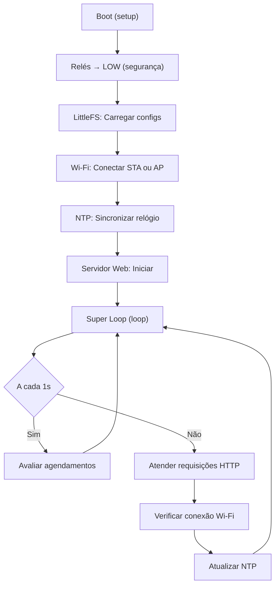

# IrrigaSolo 🌱

Sistema de irrigação automatizado baseado em agendamento de horários e controle via interface web local, utilizando microcontrolador ESP8266 (NodeMCU) com conectividade Wi-Fi.

O nome **IrrigaSolo** reflete seu duplo propósito: cuidar do **solo** e operar de forma autônoma (**solo**).

---

## Objetivo

Este projeto foi desenvolvido como material de estudo para estudantes de tecnologia interessados em:

- **Sistemas Embarcados:** Programação de microcontroladores com restrições reais de memória e processamento.
- **IoT (Internet das Coisas):** Comunicação Wi-Fi, servidores web embarcados e sincronização de tempo via NTP.
- **Automação Residencial:** Controle de válvulas solenoides para irrigação de jardins.

## Componentes de Hardware

| Componente | Descrição |
|---|---|
| NodeMCU ESP-12E (v0.9) | Microcontrolador com Wi-Fi integrado |
| Módulo Relé 2 Canais | Isolamento optoacoplado para acionamento seguro |
| 2× Válvula Solenoide 220V | Tipo máquina de lavar (normalmente fechada) |
| Fonte 5V | Alimentação do NodeMCU e relés |

## Estrutura do Projeto

```
IrrigacaoJardins/
├── doc/            # Especificação e decisões arquiteturais (ADRs)
├── include/        # Headers (.h), HTMLs e definições de hardware
├── lib/            # Bibliotecas externas (gerenciadas pelo PlatformIO)
├── src/            # Código-fonte principal do firmware
├── test/           # Testes unitários
├── html2c.py       # Script de build: converte HTML → PROGMEM
├── platformio.ini  # Configuração do PlatformIO
└── TASKS.md        # Quadro de tarefas e progresso
```

## Arquitetura

O sistema opera em **Super Loop** (polling) com módulos desacoplados:



## Como Compilar

```bash
# Via PlatformIO CLI
pio run -e nodemcu

# Upload para o hardware
pio run -e nodemcu --target upload
```

## Documentação Completa

- [Especificação Funcional](doc/specification.md)
- [Decisões Arquiteturais (ADRs)](doc/architecture.md)

## Licença

Projeto educacional de uso livre.
