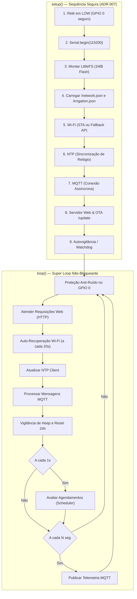

# IrrigaSolo 🌱 (Variante ESP-01S)

Sistema de irrigação automatizado baseado em agendamento de horários, controle via interface web local e monitoramento/controle remoto via protocolo MQTT, adaptado para o microcontrolador **ESP8266 ESP-01S** integrado a um módulo de relé dedicado.

O nome **IrrigaSolo** reflete seu duplo propósito: cuidar do **solo** e operar de forma autônoma (**solo**).

---

## Objetivo

Este projeto foi desenvolvido como material didático para estudantes de tecnologia e pesquisadores interessados em:

- **Sistemas Embarcados com Restrições Severas:** Otimização para microcontroladores compactos com 1MB de Flash e número reduzido de GPIOs (ESP-01S).
- **IoT (Internet das Coisas):** Conectividade Wi-Fi com portal de configuração de fallback (AP/STA), cliente MQTT assíncrono para telemetria/comandos e sincronização de tempo via NTP.
- **Automação Residencial Segura:** Acionamento de válvula solenoide com proteção térmica fracionada, auto-verificação anti-ruído elétrico no pino do relé e atualizações de firmware sem fio (OTA).

---

## Componentes de Hardware e Pinagem

| Componente | Pino no ESP-01S | Descrição |
|---|---|---|
| **ESP8266 ESP-01S** | — | Módulo com 1MB de memória Flash SPI (board `esp01_1m`) |
| **Módulo Relé 1 Canal v4.0** | **GPIO 0** | Acionamento da válvula solenoide via transistor NPN (Active HIGH: `HIGH` = Ligado, `LOW` = Desligado) |
| **LED Indicador de Status** | **GPIO 2** | LED azul onboard do ESP-01S (Active LOW: `LOW` = Aceso, `HIGH` = Apagado) |
| **Válvula Solenoide** | — | Válvula 220V/127V (tipo máquina de lavar roupas) |
| **Fonte de Alimentação** | — | Fonte DC 5V (alimenta a bobina do relé e o regulador de 3.3V do ESP-01S) |

> **Nota Arquitetural (ADR-014):** Devido à limitação física de pinos do ESP-01S, o sensor de fluxo presente em protótipos anteriores com NodeMCU foi descontinuado nesta variante. O controle do consumo de água é baseado estritamente na gestão precisa do tempo de irrigação.

---

## Estrutura do Projeto

```
IrrigaSolo/
├── doc/                     # Fonte única de verdade: especificação (RF/CA) e arquitetura (ADRs)
├── include/                 # Headers C++ (.h) e gerador de templates
│   └── templates/           # Código-fonte HTML/CSS/JS e script html2c.py
├── lib/                     # Bibliotecas locais ou gerenciadas pelo PlatformIO
├── src/                     # Implementações modulares do firmware em C++
├── test/                    # Estrutura de testes
├── platformio.ini           # Configuração do ambiente esp01_1m (LittleFS 1MB)
├── TASKS.md                 # Quadro de planejamento e histórico incremental de tarefas
└── Anotacoes.md             # Notas técnicas e guia de gravação USB-Serial
```

---

## Arquitetura de Execução

O firmware opera sob a filosofia de **Super Loop Não-Bloqueante** (ADR-005) em conjunto com a sequência de inicialização segura (ADR-007):



---

## Como Compilar e Gravar

### 1. Compilação do Firmware
Certifique-se de ter o PlatformIO instalado:

```bash
# Compilar firmware para ESP-01S (1MB)
pio run -e esp01_1m
```

### 2. Gravação Cabeada (USB-Serial)
O ESP-01S requer um adaptador USB-Serial (FTDI, CP2102 ou CH340) configurado para **3.3V**:
1. Conecte o pino **GPIO 0 ao GND** durante a energização para entrar em modo *Bootloader / UART Download*.
2. Execute o comando de gravação:
```bash
pio run -e esp01_1m --target upload
```
3. Desconecte o GPIO 0 do GND e reinicie a placa para executar o firmware em modo normal.

### 3. Atualização Remota (OTA)
Após a primeira gravação cabeada, atualizações subsequentes podem ser realizadas sem fios:
- Acesse `http://<IP_DO_DISPOSITIVO>/update` pelo navegador.
- Selecione o arquivo `.pio/build/esp01_1m/firmware.bin` gerado na compilação e confirme o envio.

---

## Documentação Detalhada

- [Especificação de Requisitos e Critérios de Aceitação](doc/specification.md)
- [Registro de Decisões Arquiteturais (ADRs)](doc/architecture.md)
- [Quadro de Tarefas Incremental](TASKS.md)
- [Anotações Técnicas e Soluções de Hardware](Anotacoes.md)

---

## Licença

Projeto acadêmico e educacional de uso livre sob licença MIT/Open Source.
