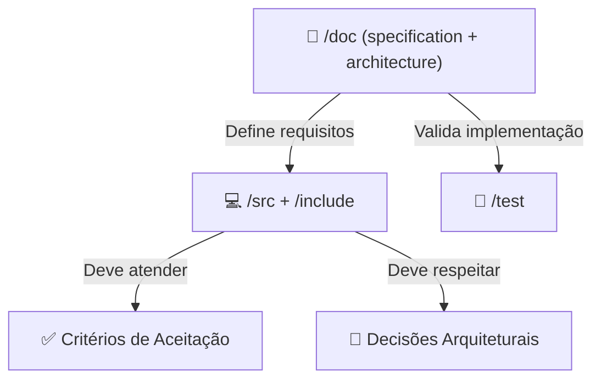

# Diretório `/doc` — Especificação e Arquitetura

## Objetivo

Este diretório é a **fonte única de verdade** (Single Source of Truth) para o comportamento, escopo e decisões técnicas do sistema IrrigaSolo. Todo código implementado deve estar rigorosamente alinhado com os documentos aqui presentes, seguindo a metodologia SDD (Desenvolvimento Guiado por Especificação).

## Conteúdo

| Arquivo | Responsabilidade |
|---|---|
| [specification.md](specification.md) | Requisitos funcionais (RF1–RF7) e critérios de aceitação (CA-01–CA-06). |
| [architecture.md](architecture.md) | Registro de Decisões Arquiteturais (ADR-001 a ADR-010). |

## Dependências / Relações

Estes documentos são consultados **antes** de qualquer implementação. O fluxo de trabalho é:

> **Para estudantes:** Sempre leia estes documentos antes de analisar o código. Eles explicam o "porquê" de cada decisão técnica, enquanto o código mostra o "como".
