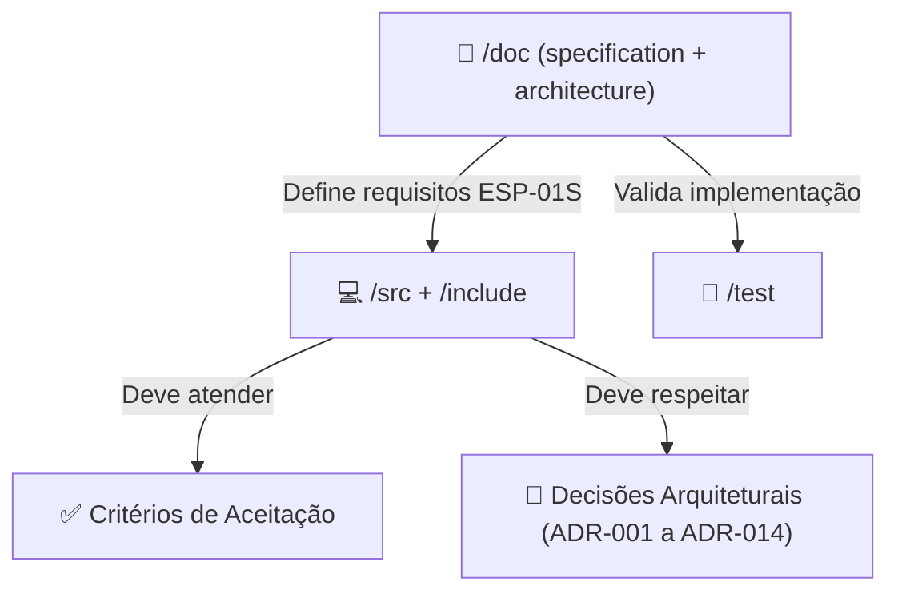

# Diretório `/doc` — Especificação e Arquitetura

## Objetivo

Este diretório é a **fonte única de verdade** (*Single Source of Truth*) para o comportamento, escopo e decisões técnicas do sistema IrrigaSolo adaptado para o microcontrolador **ESP8266 ESP-01S** acoplado ao módulo relé. Todo código implementado deve estar rigorosamente alinhado com os documentos aqui presentes, seguindo a metodologia SDD (*Spec-Driven Development*).

## Conteúdo

| Arquivo | Responsabilidade |
|---|---|
| [specification.md](specification.md) | Requisitos funcionais (RF1–RF7) e critérios de aceitação (CA-01–CA-09) para a variante ESP-01S. |
| [architecture.md](architecture.md) | Registro de Decisões Arquiteturais (ADR-001 a ADR-014), documentando a migração para o ESP-01S, descontinuação do sensor de fluxo e pinagem segura. |

## Dependências / Relações

Estes documentos são consultados **antes** de qualquer implementação. O fluxo de trabalho obedece à hierarquia:

> **Para estudantes:** Sempre leia estes documentos antes de analisar o código. Eles explicam o "porquê" de cada decisão técnica (como a escolha dos pinos GPIO 0 e GPIO 2 no ESP-01S), enquanto o código mostra o "como".
