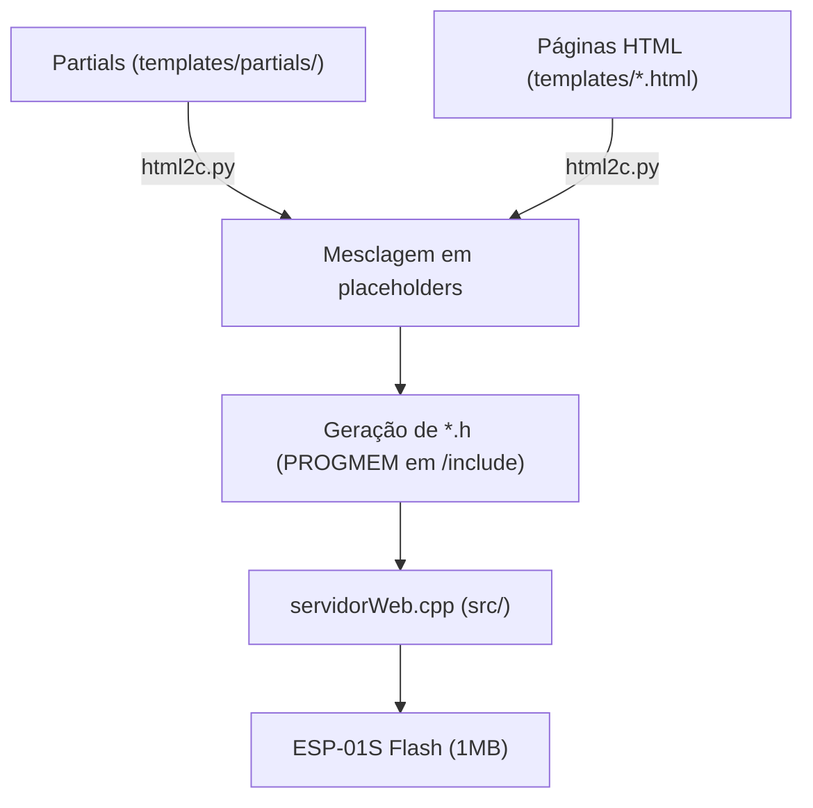

# Diretório `/include` — Headers e Páginas Web

## Objetivo

Este diretório contém os arquivos de cabeçalho (`.h`) com declarações de funções, estruturas de dados e constantes de hardware do firmware para o **ESP8266 ESP-01S**. Também armazena os arquivos HTML da interface web, que são automaticamente convertidos para headers C++ (`PROGMEM`) pelo script `html2c.py` durante o processo de compilação.

## Conteúdo

| Arquivo | Responsabilidade |
|---|---|
| [pinosHardware.h](pinosHardware.h) | Constantes de GPIOs para ESP-01S (GPIO 0 para relé e GPIO 2 para LED), limites e valores padrão. |
| [estruturas.h](estruturas.h) | Structs que mapeiam os esquemas JSON do LittleFS (ADR-004). |
| [persistencia.h](persistencia.h) | Interface do módulo de persistência LittleFS (configurações de rede, MQTT e irrigação). |
| [redeWifi.h](redeWifi.h) | Interface do módulo de gerenciamento Wi-Fi (AP/STA com fallback e auto-reconexão). |
| [relogioNtp.h](relogioNtp.h) | Interface do módulo de sincronização NTP. |
| [agendador.h](agendador.h) | Interface do motor de agendamento (Scheduler), desacoplamento assíncrono do relé (ADR-015) e proteção anti-ruído no GPIO 0. |
| [servidorWeb.h](servidorWeb.h) | Interface do servidor web embarcado (HTTP REST e OTA). |
| [clienteMqtt.h](clienteMqtt.h) | Interface de publicação e callback do cliente MQTT (telemetria, reboot e agendamentos). |
| [autovigilancia.h](autovigilancia.h) | Interface do watchdog de heap, rádio Wi-Fi, motivo de reset e reset diário de 24h. |
| [templates/](templates/) | Código-fonte das páginas HTML e templates compartilhados (`html2c.py`). |

## Dependências / Relações

Os headers deste diretório são consumidos pelos arquivos `.cpp` em `/src`. O fluxo de conversão das páginas web com suporte a blocos parciais compartilhados (partials) segue o pipeline:

Este pipeline é executado automaticamente pelo PlatformIO antes da compilação, graças ao `extra_scripts = include/templates/html2c.py` no `platformio.ini`.
