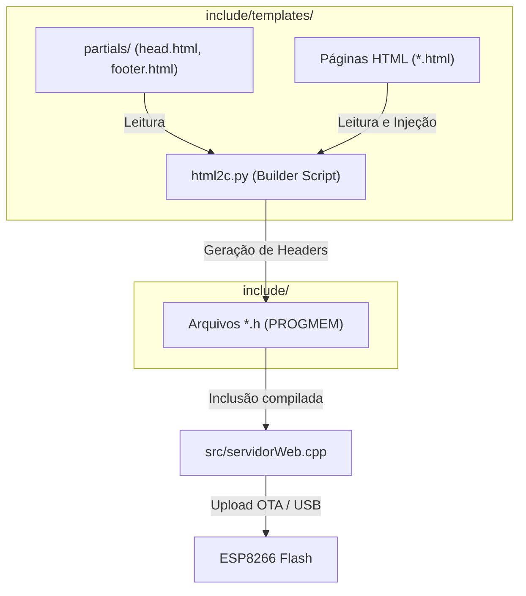

# Objetivo

Este diretório centraliza toda a lógica de desenvolvimento Web da interface do firmware IrrigaSolo. Ele armazena as páginas HTML principais e a pasta de componentes reutilizáveis (**partials**), além de hospedar o script de build responsável por empacotar e converter esses recursos em arquivos de cabeçalho do C++.

# Conteúdo

| Arquivo/Pasta | Descrição |
|---|---|
| [index.html](index.html) | Dashboard principal com controle manual e telemetria em tempo real. |
| [horarios.html](horarios.html) | Página de agendamento de horários e configuração de simultaneidade. |
| [config.html](config.html) | Página de configurações de rede, NTP e formulário OTA. |
| [partials/](partials/) | Componentes compartilhados reutilizáveis (`head.html`, `footer.html`). |
| [html2c.py](html2c.py) | Script de build em Python que processa a injeção dos partials e gera as saídas `.h`. |

# Dependências / Relações

Em tempo de compilação, o PlatformIO invoca o script [html2c.py](html2c.py) (configurado via `extra_scripts` no `platformio.ini`). O script mescla os blocos compartilhados situados na pasta `partials/` nas páginas HTML principais e escreve os headers `.h` correspondentes diretamente na raiz da pasta `/include`.

O fluxo físico atualizado é representado abaixo:

