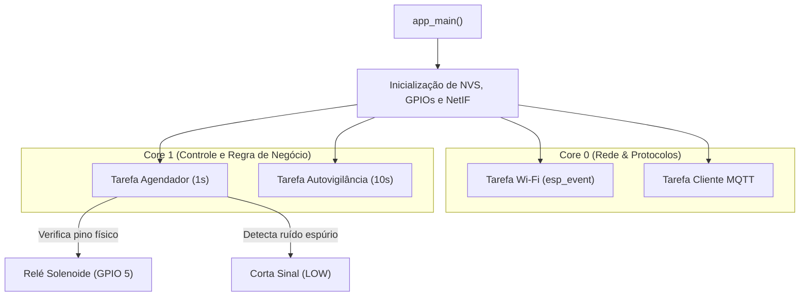

# Diretório `/migracao` — Projeto IrrigaSolo em ESP-IDF & FreeRTOS

## Objetivo

Este diretório contém a **migração didática** do firmware IrrigaSolo do framework Arduino (ESP8266) para o **ESP-IDF** (Espressif IoT Development Framework) sobre o **ESP32**.

O objetivo desta estrutura é guiar estudantes de tecnologia no aprendizado da arquitetura profissional de sistemas embarcados utilizada na indústria, demonstrando a transição de um "Super Loop" mono-tarefa para uma aplicação concorrente orientada a **Tasks do FreeRTOS**.

---

## Comparativo: Arduino vs. ESP-IDF

| Conceito | Framework Arduino (Original) | ESP-IDF (Migração) |
|---|---|---|
| **Microcontrolador** | ESP8266 (NodeMCU 80MHz) | ESP32 (Dual-Core 240MHz) |
| **Ponto de Entrada** | `void setup()` e `void loop()` | `void app_main(void)` |
| **Execução de Tarefas** | Polling não-bloqueante no Super Loop | Tasks do **FreeRTOS** (`xTaskCreatePinnedToCore`) |
| **Gerenciamento de GPIO** | `digitalWrite()`, `digitalRead()` | `gpio_set_level()`, `gpio_get_level()` |
| **Pilha de Rede Wi-Fi** | `ESP8266WiFi` (High Level) | `esp_wifi` + Event Loop (`esp_event`) |
| **Sincronização de Tempo** | `NTPClient` | `esp_sntp` nativo do ESP-IDF |
| **Protocolo MQTT** | `PubSubClient` | `esp_mqtt_client` (Nativo) |
| **Sistema de Build** | Script do PlatformIO | **CMake** + PlatformIO |

---

## Arquitetura de Tarefas (FreeRTOS)

Em vez de executar toda a lógica em um único loop, o ESP-IDF divide o sistema em tarefas concorrentes gerenciadas pelo escalonador do FreeRTOS:



---

## Como Compilar o Projeto ESP-IDF

Para compilar esta estrutura com o PlatformIO via linha de comando:

```bash
/home/rpb/.platformio/penv/bin/pio run -d migracao
```
