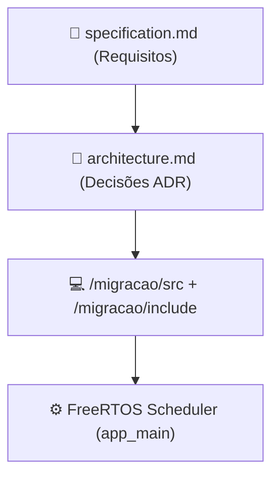

# Diretório `/migracao/doc` — Documentação do Projeto ESP8266 RTOS SDK / ESP-IDF

## Objetivo

Este diretório contém a especificação funcional e o Registro de Decisões Arquiteturais (ADR) para a versão do **IrrigaSolo** construída nativamente sobre o **ESP8266 RTOS SDK** (FreeRTOS) e **ESP-IDF** no microcontrolador NodeMCU ESP-12E v0.9.

## Conteúdo

| Arquivo | Responsabilidade |
|---|---|
| [specification.md](specification.md) | Especificação de Requisitos Funcionais (RF), Hardware e Critérios de Aceitação (CA). |
| [architecture.md](architecture.md) | Registro de Decisões Arquiteturais (ADR-IDF) da aplicação baseada em FreeRTOS. |

## Relação entre Especificação e Código

