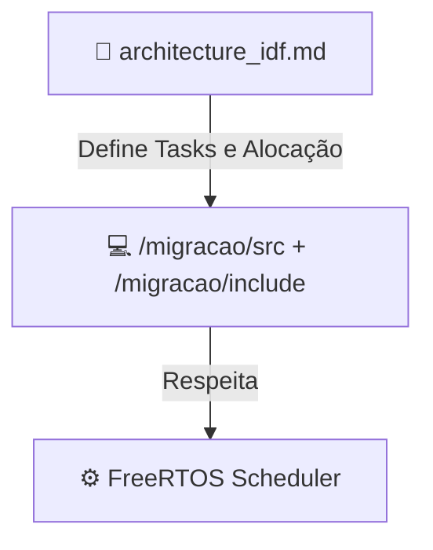

# Diretório `/migracao/doc` — Arquitetura ESP-IDF e Decisões Técnicas

## Objetivo

Este diretório armazena a documentação arquitetural da migração do sistema IrrigaSolo para a plataforma **ESP-IDF** com **FreeRTOS**.

## Conteúdo

| Arquivo | Responsabilidade |
|---|---|
| [architecture_idf.md](architecture_idf.md) | Registro de Decisões Arquiteturais (ADR-IDF) para a implementação em ESP-IDF. |

## Relação de Dependências

