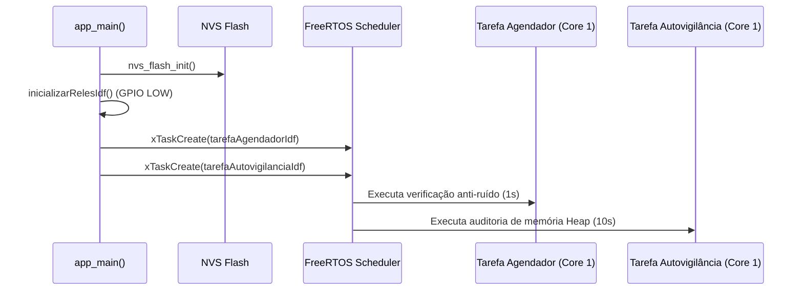

# Diretório `/migracao/src` — Código-Fonte ESP-IDF (C / FreeRTOS)

## Objetivo

Este diretório contém os arquivos de código-fonte (`.c`) da migração do sistema IrrigaSolo para **ESP-IDF** (ESP32).

Cada módulo é implementado utilizando os drivers de hardware nativos da Espressif e tarefas multithread do **FreeRTOS**.

## Conteúdo

| Arquivo | Responsabilidade |
|---|---|
| `main.c` | Ponto de entrada `app_main()`. Inicializa a memória NVS, GPIOs e cria as tarefas FreeRTOS. |
| `agendador.c` | Tarefa `tarefaAgendadorIdf` (1s) com auto-verificação do pino do relé contra ruído. |
| `autovigilancia.c` | Tarefa `tarefaAutovigilanciaIdf` para monitoramento de heap e captura de razão de reset (`esp_reset_reason`). |
| `redeWifi.c` | Driver de rede baseado na pilha `esp_wifi` e manipuladores de evento `esp_event`. |
| `relogioNtp.c` | Sincronização de relógio utilizando o componente SNTP nativo do ESP-IDF (`esp_sntp`). |
| `sensorFluxo.c` | Interrupção externa de hardware de alta velocidade com o driver `driver/gpio.h`. |
| `clienteMqtt.c` | Cliente de comunicação MQTT usando o componente oficial `esp_mqtt`. |

## Arquitetura de Execução no FreeRTOS

