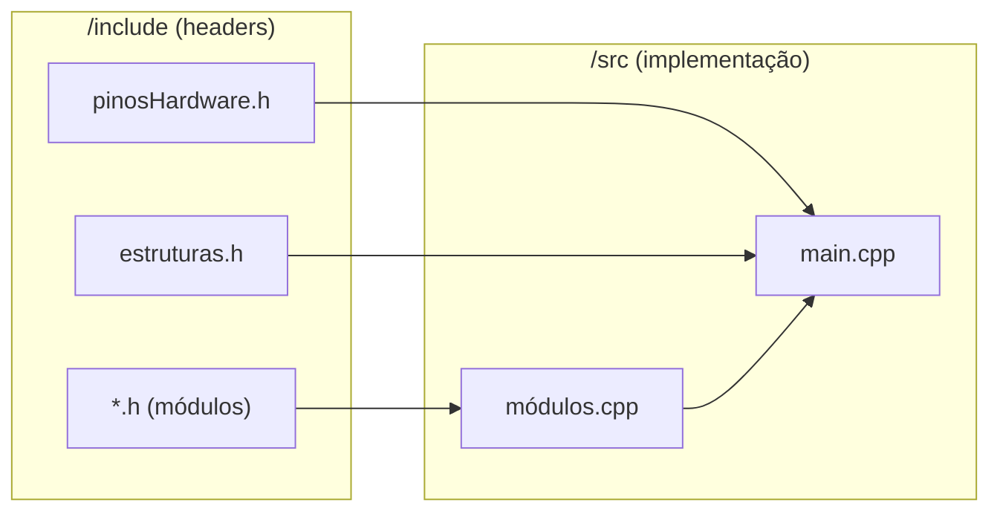
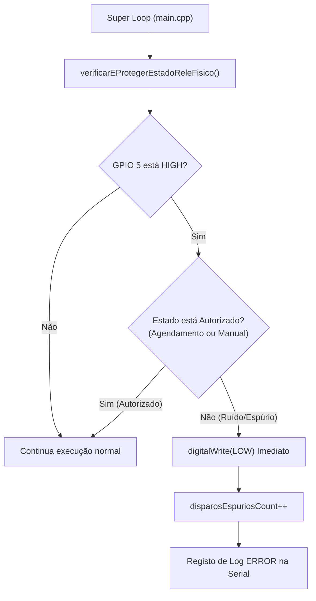

# Diretório `/src` — Código-Fonte Principal

## Objetivo

Este diretório contém os arquivos de implementação (`.cpp`) do firmware IrrigaSolo. Cada arquivo corresponde a um módulo funcional do sistema, seguindo o princípio de separação de responsabilidades.

## Conteúdo

| Arquivo | Responsabilidade |
|---|---|
| `main.cpp` | Ponto de entrada do firmware. Orquestra `setup()` e `loop()`. |
| [persistencia.cpp](persistencia.cpp) | Leitura/escrita de JSON no LittleFS (ADR-004) e volume acumulado de água. |
| [redeWifi.cpp](redeWifi.cpp) | Gerenciamento de Wi-Fi AP/STA com fallback (RF2). |
| [relogioNtp.cpp](relogioNtp.cpp) | Sincronização NTP e formatação de data/hora (RF1.2). |
| [agendador.cpp](agendador.cpp) | Motor de agendamento com controle de janela, override manual e auto-verificação anti-ruído elétrico (ADR-005, ADR-011, ADR-012). |
| [servidorWeb.cpp](servidorWeb.cpp) | Servidor HTTP com endpoints e páginas PROGMEM (ADR-002, ADR-009). |
| [sensorFluxo.cpp](sensorFluxo.cpp) | Leitura de vazão e acúmulo de volume com salvamento persistente inteligente (ADR-006). |
| [clienteMqtt.cpp](clienteMqtt.cpp) | Publicação de telemetria rica, tópicos dedicados de reboot e agendamentos e escuta de comandos via MQTT (ADR-010, ADR-012). |
| [autovigilancia.cpp](autovigilancia.cpp) | Mecanismo de Watchdog de heap, rádio Wi-Fi com auto-recuperação, motivo de reset e reset preventivo programado de 24h. |

## Dependências / Relações

Os arquivos `.cpp` deste diretório dependem dos headers (`.h`) definidos em `/include`. O `main.cpp` é o orquestrador que inicializa e coordena todos os módulos na sequência definida pelo ADR-007.

### Fluxo de Proteção Anti-Ruído Elétrico

