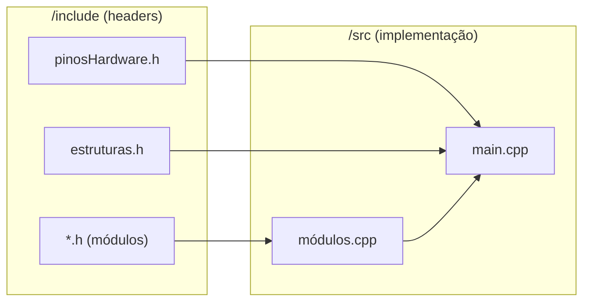
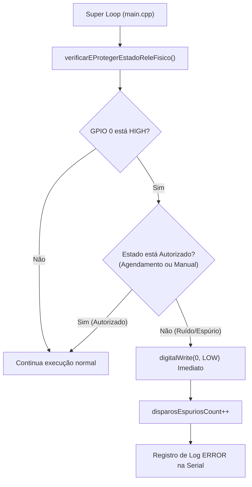

# Diretório `/src` — Código-Fonte Principal

## Objetivo

Este diretório contém os arquivos de implementação (`.cpp`) do firmware IrrigaSolo adaptado para o microcontrolador **ESP8266 ESP-01S**. Cada arquivo corresponde a um módulo funcional do sistema, seguindo o princípio de separação de responsabilidades.

## Conteúdo

| Arquivo | Responsabilidade |
|---|---|
| `main.cpp` | Ponto de entrada do firmware. Orquestra `setup()` e o Super Loop não-bloqueante (`loop()`). |
| [persistencia.cpp](persistencia.cpp) | Leitura/escrita de configurações JSON no LittleFS (`/network.json` e `/irrigation.json`, ADR-004). |
| [redeWifi.cpp](redeWifi.cpp) | Gerenciamento de Wi-Fi AP/STA com fallback e reconexão periódica assíncrona (RF2, ADR-013). |
| [relogioNtp.cpp](relogioNtp.cpp) | Sincronização NTP e formatação de data/hora (RF1.2). |
| [agendador.cpp](agendador.cpp) | Motor de agendamento, proteção térmica fracionada da solenoide, controle manual e proteção anti-ruído no GPIO 0 (ADR-005, ADR-011, ADR-012). |
| [servidorWeb.cpp](servidorWeb.cpp) | Servidor HTTP com endpoints RESTful, OTA `/update` e páginas servidas via PROGMEM (ADR-002, ADR-009). |
| [clienteMqtt.cpp](clienteMqtt.cpp) | Publicação de telemetria, tópicos dedicados de reboot e agendamentos, e recepção assíncrona de comandos (ADR-010, ADR-012). |
| [autovigilancia.cpp](autovigilancia.cpp) | Watchdog de heap, auto-recuperação do rádio Wi-Fi, motivo de reset e reset preventivo de 24h. |

## Dependências / Relações

Os arquivos `.cpp` deste diretório dependem dos headers (`.h`) definidos em `/include`. O `main.cpp` é o orquestrador que inicializa e coordena todos os módulos na sequência estrita definida pelo ADR-007.

### Fluxo de Proteção Anti-Ruído Elétrico no GPIO 0

