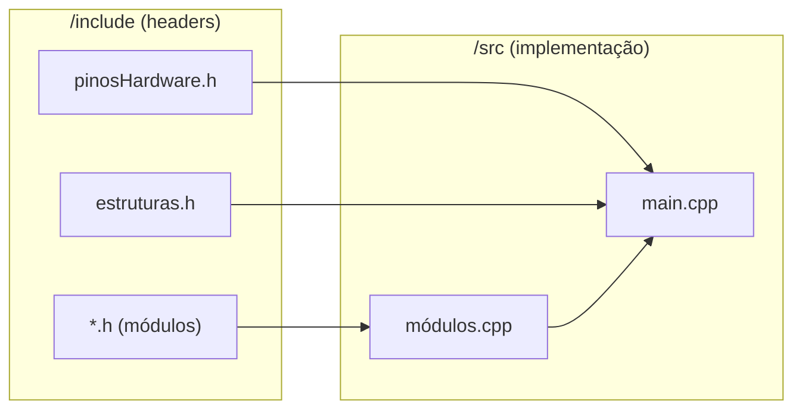

# Diretório `/src` — Código-Fonte Principal

## Objetivo

Este diretório contém os arquivos de implementação (`.cpp`) do firmware IrrigaSolo. Cada arquivo corresponde a um módulo funcional do sistema, seguindo o princípio de separação de responsabilidades.

## Conteúdo

| Arquivo | Responsabilidade |
|---|---|
| `main.cpp` | Ponto de entrada do firmware. Orquestra `setup()` e `loop()`. |
| [persistencia.cpp](persistencia.cpp) | Leitura/escrita de JSON no LittleFS (ADR-004). |
| [redeWifi.cpp](redeWifi.cpp) | Gerenciamento de Wi-Fi AP/STA com fallback (RF2). |
| [relogioNtp.cpp](relogioNtp.cpp) | Sincronização NTP e formatação de data/hora (RF1.2). |
| [agendador.cpp](agendador.cpp) | Motor de agendamento com validação de conflitos (ADR-005, ADR-006). |

> **Nota:** Novos módulos (`.cpp`) serão adicionados conforme as etapas de implementação avançam.

## Dependências / Relações

Os arquivos `.cpp` deste diretório dependem dos headers (`.h`) definidos em `/include`. O `main.cpp` é o orquestrador que inicializa e coordena todos os módulos na sequência definida pelo ADR-007.

